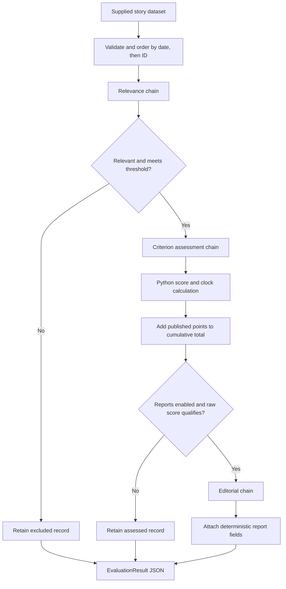
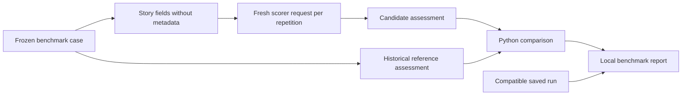

# Architecture

The application turns supplied evidence into inspectable criterion ratings, deterministic scores and optional editorial reports. Collection is a caller responsibility. The same assessment contract and arithmetic also power a separate benchmark runner.

The orchestration is an explicit sequence of Python functions. `llm.run_chain` sends structured requests through the OpenAI Responses SDK; the current implementation does not require a LangChain runnable, graph, database or background service.

## The evaluation path

The relevance chain receives the story and returns a relevance flag, score, rationale and primary dimension. Both the flag and configured threshold must permit progression. Relevance measures fit with the index; it does not assign criterion points.

The scorer receives the story and validated relevance result. It returns eight ratings and their rationales, uncertainty notes and a leading-indicator flag. Python then derives the weighted score, severity and symbolic clock movement. The report gate uses `raw_source_total`; accumulation uses the published `total_score`. See [Methodology](methodology.md) for the distinction.

The optional writer receives the story, relevance, assessment and calculation. It returns four prose fields. Python attaches the incident ID and authoritative severity and clock labels, keeping presentation decisions separate from arithmetic.

## State and failure boundaries

Events run sequentially in `(published_date, id)` order. The application keeps a cumulative evidence total for clock calculations, starting from `clock.initial_evidence_points`. This number is accounting state, not model memory: relevance and scoring requests do not receive previous stories or assessments. Each chain begins with a fresh request; only a schema-correction attempt includes the preceding invalid response.

The caller must supply one selected source per event. Unique IDs prevent exact ID duplication within a dataset, but the application does not recognise differently named records of the same event. Seeding a cumulative total does not prevent recounting events from an earlier run.

Expected stage failures are recorded against the affected story, and later stories continue. Failed relevance or assessment does not become a zero rating. A calculation failure preserves the assessment without adding points. A writer failure preserves the completed calculation and its contribution to the cumulative total: evidence accounting has already succeeded, even though the record's status becomes `error`.

`EvaluationResult.complete` is false if any story has an error. Excluded stories and assessments below the reporting threshold are valid completed outcomes. Consumers should inspect stage fields as well as status when handling partial results.

## The benchmark path

Historical references, tags and provenance never enter the model request. The benchmark skips relevance and writing, forces web search off, and calculates every case from zero cumulative points. Its first local run establishes a reproducible comparison baseline; historical agreement alone is not correctness. The [benchmark guide](benchmarking.md) explains interpretation and coverage limits.

## External boundaries

Prompts are packaged text resources and output schemas come from Pydantic models. Without optional scorer search, URLs identify sources but are not fetched. Hosted search, when enabled for normal evaluation, can check the supplied story; it does not collect new stories.

The CLI owns its API client and applies configured timeouts and transport retries. Python callers inject and manage their own client. Both runners write local JSON; neither persists conversational history nor uploads LangSmith experiments. Output records retain configuration, prompt fingerprints, response metadata and available usage. Benchmark reports additionally fingerprint the evidence and relevant source files.

Continue with the [component map](components.md) for module responsibilities and [key decisions](decisions.md) for the tradeoffs behind these boundaries.
